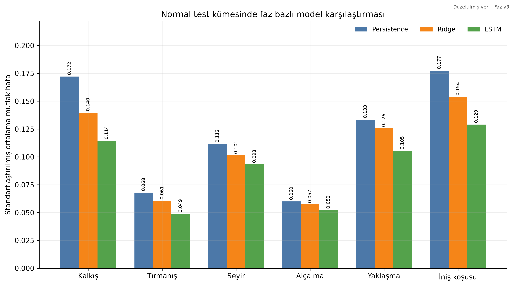
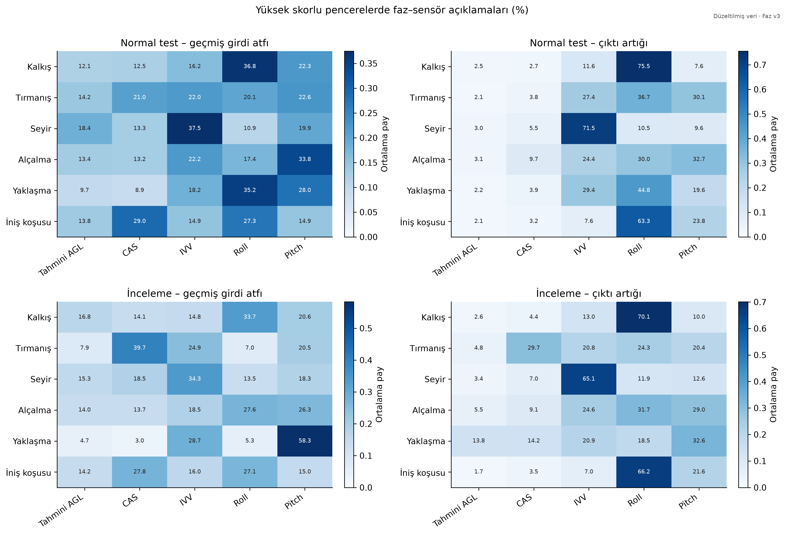

# Phase-Aware Flight Data Analytics ✈️

**A research showcase by Halime Nur Delen**

My master's research studies flight behavior using NASA-style Flight Data Recorder (FDR) sensor time series. I compare forecasting models across flight phases, examine candidate anomalies, and use explainable AI to understand selected model decisions.

This public page presents a project overview and selected aggregate results. The full research code, detailed experiment artifacts, raw data, and model checkpoints are kept outside this showcase.

## What I worked on

- Data quality checks and alignment of flight sensor channels.
- Flight-phase identification and flight-level train/validation/test separation.
- Persistence and Ridge baselines alongside phase-specific LSTM forecasting.
- Synthetic sensor-disturbance evaluation and CAS early-warning experiments.
- Integrated Gradients explanations and flight-event visualization.

## Selected results

The offline experiment used 3,672 flights. On the normal test set, mean standardized forecasting error was:

| Model | Mean forecasting error |
|---|---:|
| Persistence | 0.087844 |
| Ridge | 0.080167 |
| Phase-specific LSTM | 0.070249 |

LSTM forecasting error was 20.03% lower than Persistence and 12.37% lower than Ridge. These percentages measure forecasting-error reduction, not fault-detection accuracy.

The synthetic CAS early-warning task remains challenging: the WITHIN_30S head alarmed on 10.93% of samples 30 seconds before synthetic failure, compared with 3.98% on clean reference samples, using a validation-selected threshold with a 5% false-positive target.

## Scope and limitations

This is an offline academic research experiment. Phase assignment uses full-flight information; live operation has not been validated. Synthetic disturbances do not establish real-fault detection performance. Model attributions help explain predictions but do not prove physical fault causes.

## Tools

Python · NumPy · Pandas · SciPy · PyTorch · Matplotlib

Research areas: aviation data analytics, time-series forecasting, explainable AI, and predictive maintenance.
